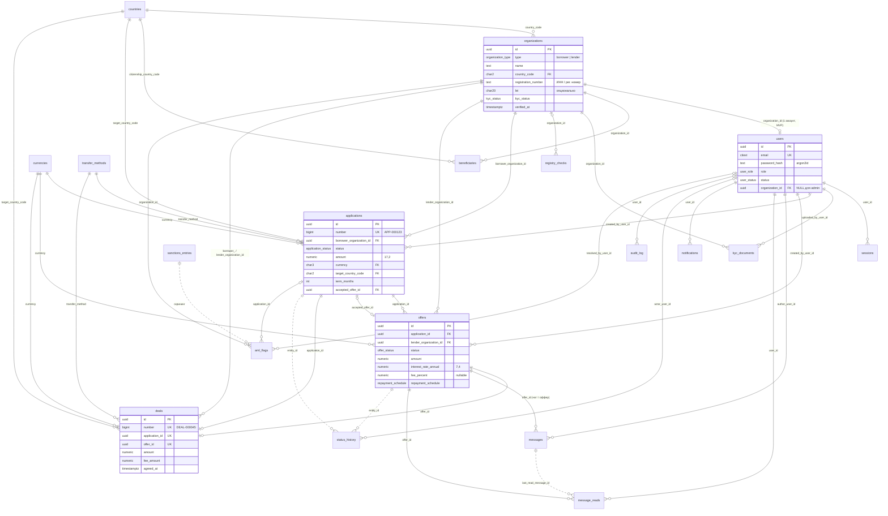

# Схема БД

PostgreSQL 16. Миграции лежат в `backend/migrations` в формате [goose](https://github.com/pressly/goose). Схема соответствует контракту `api/openapi.yaml` v0.1.0. Решения, на которых она построена, описаны в [ADR-0001](../adr/0001-architecture-and-api-contract.md).

| Файл | Что делает |
|---|---|
| `00001_init.sql` | Расширения, enum-типы, все таблицы, индексы, триггеры `updated_at` |
| `00002_seed_dictionaries.sql` | Справочники: страны (с FATF и «недружественностью»), валюты, способы перевода |
| `testdata/invariants_test.sql` | Smoke-тест ограничений: 19 проверок, в том числе транзакция принятия оффера |

## Как запустить

```bash
# применить
goose -dir backend/migrations postgres "$DATABASE_URL" up
# проверить инварианты (всё в транзакции, откатывается)
psql "$DATABASE_URL" -f backend/migrations/testdata/invariants_test.sql
# откатить всё
goose -dir backend/migrations postgres "$DATABASE_URL" reset
```

sqlc читает goose-миграции напрямую: в `backend/sqlc.yaml` указано `schema: migrations`, `queries: queries`. Код генерируется в `backend/internal/repository/sqlc` (пакет `repository`, драйвер `pgx/v5`).

**Описание каждой таблицы** — поля, типы Go, ограничения, связи и sqlc-запросы — лежит в [tables/](tables/README.md).

## ER-диаграмма

Все внешние ключи. Сплошная линия — FK, пунктир — логическая связь без FK. `|o` — FK допускает NULL.



Связи без внешних ключей (пунктир на диаграмме):
- `status_history`, `notifications`, `audit_log` ссылаются на сущности полиморфно через `entity_type` + `entity_id`. На диаграмме показаны только основные случаи `status_history`;
- `message_reads.last_read_message_id` хранит `messages.id` без FK;
- `sanctions_entries` не связана ни с чем: это источник данных для флагов `aml_flags` с `rule = sanctions_match`.

## Таблицы

### Справочники

| Таблица | Назначение | API |
|---|---|---|
| `countries` | ISO 3166-1 alpha-2, названия ru/en, `fatf_list` (`black`/`grey`/NULL) + `fatf_as_of`, `is_unfriendly` | `GET /dictionaries/countries`. Поле `fatf_high_risk = fatf_list IS NOT NULL` |
| `currencies` | ISO 4217 | `GET /dictionaries/currencies` |
| `transfer_methods` | swift / sepa / other | `GET /dictionaries/transfer-methods` |

В сиде не полный ISO, а около 30 стран, нужных для демо и типичных юрисдикций. Чёрный список FATF взят по итогам пленара июня 2026. Серый список и перечень недружественных стран (распоряжение № 430-р) нужно сверить с первоисточниками: это отдельная задача.

### Организации и пользователи

- **`organizations`** — юрлицо, которое проходит KYC. Статус `kyc_status` хранится здесь, а не у пользователя.
- **`beneficiaries`** — бенефициары из `PATCH /organizations/me`. Обновлять заменой списка целиком: delete + insert в одной транзакции.
- **`users`** — учётные записи.
  - `email` типа `citext`, поэтому `Alpha@x.com` и `alpha@x.com` — один пользователь.
  - У админа `organization_id IS NULL`.
- **`sessions`** — серверные сессии.
  - В cookie лежит случайный токен (32 байта), в БД хранится только `sha256(token)`. Утечка БД не даёт войти.
  - Блокировка пользователя: `DELETE FROM sessions WHERE user_id = $1`.
  - Просроченные сессии чистит периодическая задача: `DELETE … WHERE expires_at < now()`.

### KYC

- **`kyc_documents`** — метаданные файлов.
  - Сам файл лежит на диске или в S3 под `storage_key` (случайное имя), вне веб-корня.
  - `file_name` нужен только для показа: экранируется и в путях не используется.
  - MIME проверяется по содержимому файла. CHECK в БД — вторая линия защиты.
- **`registry_checks`** — сырые ответы DaData и GLEIF (или мока) с датой. Это доказательная база проверки, её видит админ в `GET /admin/organizations/{id}` (`registry_check`).

### Маркетплейс

- **`applications`** — заявки заёмщиков. Номер `number` выдаётся автоматически (identity), фронт показывает его как `APP-%06d`.
- **`offers`** — предложения кредиторов. Чат привязан к офферу, то есть к паре «заёмщик ↔ кредитор» по конкретной заявке.
- **`deals`** — неизменяемый снапшот условий на момент принятия. `fee_amount = round(amount × fee_percent / 100, 2)` считает бэкенд.
- **`messages`** + **`message_reads`** — чат с polling по `id > after_id`. По указателю «прочитано до» считается `unread_messages`.

### Служебные

- **`notifications`** пишутся в той же транзакции, что и событие, без брокера.
- **`status_history`** — каждый переход статуса заявки, оффера или KYC. Отдаётся в `GET /applications/{id}/history`.
- **`aml_flags`** — результаты rule-based скрининга, админ их разбирает.
- **`sanctions_entries`** — загруженные списки OFAC/EU/UN/UK (или мок), с GIN-индексом `pg_trgm` для нечёткого поиска.
- **`audit_log`** — журнал действий: логин, неудачный логин, загрузка документа, решения админа и т. д. Только INSERT.

## Где проверяется каждый инвариант

Правило такое: если нарушение инварианта означает испорченные данные, он защищён в БД. Если это бизнес-правило, которое может поменяться, или проверка, требующая данных из другой таблицы, он проверяется в сервисе и покрывается модульными тестами.

| Инвариант | Где |
|---|---|
| Заёмщик только из RU, кредитор не из RU | БД `organizations_type_country_chk` |
| Рег. номер уникален в пределах страны, LEI уникален | БД |
| `verified` ⇔ `verified_at` заполнен | БД |
| Админ без компании, остальные с компанией | БД `users_admin_org_chk` |
| Один аккаунт на компанию (решение для MVP) | БД `users_one_per_org_uq`. Чтобы снять — удалить индекс |
| Роль пользователя совпадает с типом организации | **Сервис** регистрации |
| Создавать заявки и офферы можно только при `kyc_status = verified` | **HTTP-middleware** по `x-kyc-required` и сервис |
| Разрешённые переходы статусов | **Сервис** (таблица переходов + табличные тесты) |
| `agreed` ⇔ есть `accepted_offer_id` | БД `applications_agreed_chk` |
| Один активный оффер компании на заявку | БД `offers_one_active_per_lender_uq` |
| Не больше одного принятого оффера на заявку | БД `offers_one_accepted_uq` — страховка от гонки |
| Одна сделка на заявку и на оффер | БД `UNIQUE` |
| Сумма оффера ≤ суммы заявки, валюта оффера = валюта заявки | **Сервис** (нужны данные другой таблицы) |
| `rejected` ⇔ указана причина; `sent` ⇔ нет `decided_at` | БД |
| Деньги > 0, проценты в разумных пределах, длины строк | БД `CHECK` + валидация по OpenAPI |
| Только PDF/PNG/JPEG, файлы ≤ 10 MB | **Сервис** (по содержимому) + БД |
| Закрытый AML-флаг ⇔ есть кто и когда закрыл | БД |
| Доступ только к своим сущностям (IDOR) | **Репозиторий**: запросы `*Visible` с обязательными `viewer_role`/`viewer_org`; чужое и несуществующее → 0 строк → `404` |

## Ключевые запросы

### Принятие оффера (`POST /offers/{offerId}/accept`)

Всё выполняется в одной транзакции (`service.Deals.AcceptOffer`). `FOR UPDATE` на заявке сериализует параллельные клики: в `READ COMMITTED` вторая транзакция после ожидания видит новую версию строки (`agreed`) и получает 409. Если гонка всё же прорвётся, второй коммит упадёт на `offers_one_accepted_uq` / `deals_application_id_key` / `deals_offer_id_key` — сервис отвечает тем же 409 `INVALID_STATUS_TRANSITION`.

```sql
BEGIN;
-- 1. Блокируем заявку и проверяем владельца (LockApplicationByOfferForBorrower).
--    Статус НЕ фильтруется: иначе «уже agreed» и «чужая» обе дали бы 0 строк,
--    и 404 от 409 не отличить. Статус заявки сервис проверяет по заблокированной
--    строке → 409.
SELECT a.* FROM applications a
  JOIN offers o ON o.application_id = a.id
 WHERE o.id = $offer_id
   AND a.borrower_organization_id = $my_org_id     -- IDOR: чужая заявка → 0 строк → 404
   FOR UPDATE OF a;

-- 2. Блокируем сам оффер (LockOfferForAccept): статус (sent) и valid_until сервис
--    проверяет по заблокированной строке → 409; условия до снапшота не поменяются.
SELECT * FROM offers WHERE id = $offer_id AND application_id = $app_id FOR UPDATE;

-- 3. Принимаем оффер (должна обновиться ровно 1 строка, иначе 409); снапшот сделки —
--    из RETURNING этой строки
UPDATE offers SET status = 'accepted', decided_at = now()
 WHERE id = $offer_id AND status = 'sent' AND application_id = $app_id
RETURNING *;

-- 4. Остальные активные офферы отклоняем
UPDATE offers SET status = 'rejected', reject_reason = 'another_offer_accepted', decided_at = now()
 WHERE application_id = $app_id AND status = 'sent'
RETURNING id, lender_organization_id;              -- им нужны уведомления

-- 5. Заявка → agreed
UPDATE applications SET status = 'agreed', accepted_offer_id = $offer_id
 WHERE id = $app_id AND status = 'published';

-- 6. Снапшот сделки: fee_amount = round(amount × fee_percent / 100, 2) считает сервис
-- 7. status_history, 8. notifications, 9. audit_log
INSERT INTO deals (...) VALUES (...) RETURNING *;
COMMIT;
```

### Витрина кредитора (`GET /applications` под ролью lender)

```sql
SELECT a.*, o.name, o.country_code,
       (SELECT id FROM offers WHERE application_id = a.id
          AND lender_organization_id = $my_org_id AND status = 'sent') AS my_offer_id
  FROM applications a
  JOIN organizations o ON o.id = a.borrower_organization_id
 WHERE (a.status = 'published'
        OR EXISTS (SELECT 1 FROM offers f WHERE f.application_id = a.id
                     AND f.lender_organization_id = $my_org_id))      -- архив своих откликов
   AND ($country::char(2) IS NULL OR a.target_country_code = $country)
   AND ($currency::char(3) IS NULL OR a.currency = $currency)
   AND ($amount_min::numeric IS NULL OR a.amount >= $amount_min)
   AND ($amount_max::numeric IS NULL OR a.amount <= $amount_max)
   AND ($term_min::int IS NULL OR a.term_months >= $term_min)
   AND ($term_max::int IS NULL OR a.term_months <= $term_max)
 ORDER BY a.published_at DESC NULLS LAST
 LIMIT $page_size OFFSET ($page - 1) * $page_size;
```

Индекс `applications_showcase_idx (target_country_code, currency, amount) WHERE status = 'published'` покрывает основной фильтр.

### Аналитика (`GET /admin/analytics/summary`)

```sql
-- Средний размер по каждой валюте отдельно (без конвертации)
SELECT currency, count(*), sum(amount), round(avg(amount), 2)
  FROM applications WHERE status NOT IN ('draft') AND created_at BETWEEN $from AND $to
 GROUP BY currency;

-- Топ стран спроса (куда хотят деньги)
SELECT target_country_code, count(*) FROM applications
 WHERE status IN ('published', 'agreed') GROUP BY 1 ORDER BY 2 DESC LIMIT $n;

-- Топ стран предложения (откуда кредиторы, сделавшие офферы)
SELECT org.country_code, count(DISTINCT o.id) FROM offers o
  JOIN organizations org ON org.id = o.lender_organization_id
 GROUP BY 1 ORDER BY 2 DESC LIMIT $n;
```

### Санкционный скрининг

```sql
SET pg_trgm.similarity_threshold = 0.4;            -- широкий отбор кандидатов
SELECT id, source, name, similarity(name_normalized, $q) AS score
  FROM sanctions_entries
 WHERE name_normalized % $q
 ORDER BY score DESC LIMIT 20;
-- Кандидатов досчитать Jaro-Winkler в Go. ≥ 0.90 → флаг high, 0.85–0.90 → medium (ручная проверка).
```

Перед поиском имя нормализуется одинаково для списка и для запроса:
- нижний регистр;
- транслитерация кириллицы в латиницу;
- удаление орг. форм (ООО, LLC, Ltd, GmbH);
- схлопывание пробелов.

## Покрытие sqlc

74 запроса в 11 файлах `backend/queries/*.sql`. Сгенерированный интерфейс `Querier` (`internal/repository/sqlc/querier.go`) с ними совпадает. Подробно по таблицам — в [tables/](tables/README.md).

| Файл | Таблицы | Запросы |
|---|---|---|
| `dictionaries.sql` | countries, currencies, transfer_methods | `ListCountries`, `ListCurrencies`, `ListTransferMethods` |
| `users.sql` | users | `GetUserByID`, `GetUserByEmail`, `CreateUser`, `UpdateLastLogin`, `BlockUser`, `UnblockUser`, `ListUsers`, `CountUsers` |
| `sessions.sql` | sessions (+ users, organizations) | `CreateSession`, `GetSessionByTokenHash`, `TouchSession`, `DeleteSessionByTokenHash`, `DeleteSessionsByUserID`, `DeleteExpiredSessions` |
| `organizations.sql` | organizations | `CreateOrganization`, `GetOrganizationByID`, `GetOrganizationForUpdate`, `UpdateOrganization`, `SubmitKycForReview`, `ApproveKyc`, `RejectKyc`, `ListOrganizations`, `CountOrganizations`, `ListBeneficiariesByOrg`, `DeleteBeneficiariesByOrg`, `CreateBeneficiary` |
| `kyc.sql` | kyc_documents, registry_checks | `CreateKycDocument`, `ListKycDocumentsByOrg`, `GetKycDocumentVisible`, `DeleteKycDocument`, `CreateRegistryCheck`, `GetLatestRegistryCheck` |
| `applications.sql` | applications, status_history | `CreateApplication`, `GetApplicationVisible`, `LockApplicationByOfferForBorrower`, `UpdateApplication`, `SubmitApplication`, `ApproveApplication`, `RejectApplication`, `CancelApplication`, `AgreeApplication`, `ListApplicationsVisible`, `CountApplicationsVisible`, `CreateStatusHistory` |
| `offers.sql` | offers | `CreateOffer`, `GetOfferVisible`, `ListApplicationOffersVisible`, `ListOffersVisible`, `CountOffersVisible`, `LockApplicationForLender`, `LockOfferForAccept`, `AcceptOffer`, `RejectOffer`, `WithdrawOffer`, `RejectSentOffersByApplication` |
| `deals.sql` | deals | `CreateDeal`, `GetDealVisible`, `ListDealsVisible`, `CountDealsVisible` |
| `chat.sql` | messages, message_reads | `CreateMessage`, `ListMessagesVisible`, `MarkMessagesRead` (непрочитанные считают `*OffersVisible`) |
| `notifications.sql` | notifications | `CreateNotification`, `CreateNotificationsForAdmins`, `CreateNotificationsForOrganization`, `ListNotifications`, `CountNotifications`, `CountUnreadNotifications`, `MarkNotificationRead`, `MarkAllNotificationsRead` |
| `admin.sql` | aml_flags, sanctions_entries, audit_log, аналитика | `CreateAmlFlag`, `ListAmlFlags`, `ResolveAmlFlag`, `SearchSanctions`, `CreateAuditLog`, `ListAuditLog`, `GetAnalyticsSummaryByCurrency`, `GetTopDemandCountries`, `GetTopSupplyCountries` |

### Чего не хватает и где запросы расходятся с этим документом

Пробелы (запросов нет):
- `status_history` — нет чтения для `GET /applications/{id}/history`;
- `aml_flags` — нет `Count` и `GetByID`; `audit_log` — нет фильтров и `Count`;
- `sanctions_entries` — нет запросов загрузчика списков.

Расхождения с примерами выше:
- **IDOR.** Чтение заявок, офферов и сделок по `id` и их списки идут через `*Visible` с обязательными `viewer_role`/`viewer_org` (правило видимости — `OR`-ветки по ролям в `WHERE`, неизвестная роль и пустая организация видят ничего). Чат читается `ListMessagesVisible` с тем же правилом; `CreateMessage` и `MarkMessagesRead` вызываются только после `GetOfferVisible`. `LockApplicationByOfferForBorrower` проверяет владельца заявки в `WHERE`, `AcceptOffer` — принадлежность оффера заблокированной заявке. `RejectOffer` и `WithdrawOffer` проверяют организацию в самом `UPDATE`. Запросы уведомлений фильтруют по `user_id` текущего пользователя; `MarkNotificationRead` — `:execrows`, 0 строк → `404`.
- **Витрина.** `ListApplicationsVisible` не джойнит `organizations` и не возвращает `my_offer_id`; сортировка по умолчанию по `created_at`, а не по `published_at`.
- **Аналитика.** `GetAnalyticsSummaryByCurrency` исключает и `draft`, и `cancelled`, и не принимает период `from/to`.
- **Переходы статусов** заявок и решения админа по KYC (`ApproveKyc`, `RejectKyc`) не защищены условием по текущему статусу в `WHERE` (у офферов защищены: `AND status = 'sent'`, у `UpdateOrganization` и `SubmitKycForReview` — `kyc_status IN ('draft','rejected')` плюс `GetOrganizationForUpdate`). Параллельные запросы могут проскочить проверку сервиса.

## Что сознательно не делаем в MVP

- **Мягкое удаление и версионирование заявок.** Достаточно `status_history`.
- **Партиционирование `audit_log` и `messages`.** Объёмы демо этого не требуют.
- **Row-Level Security.** IDOR закрываем в репозитории. RLS — хороший следующий шаг, если останется время.
- **Конвертация валют.** Суммы и аналитика считаются по каждой валюте отдельно.
- **Чистка старых уведомлений.** Строки `notifications` не удаляются: объёмы демо малы, ленту покрывает индекс `notifications_user_idx` (DECISIONS п. 39).
