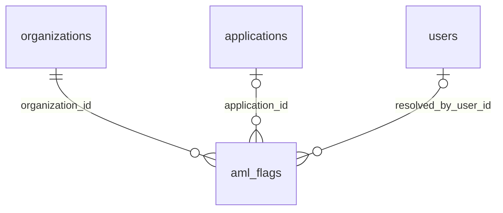

# `aml_flags`

Результаты rule-based AML-скрининга. Админ разбирает флаги и закрывает как ложное срабатывание или подтверждённый.

- Группа: служебные (AML)
- sqlc-модель: `repository.AmlFlag`
- API: `GET /admin/aml-flags`, `POST /admin/aml-flags/{id}/resolve`

## Поля

| Поле | Тип | NULL | По умолчанию | Go (sqlc) | Описание |
|---|---|---|---|---|---|
| `id` | `bigint` identity PK | нет | — | `int64` | |
| `organization_id` | `uuid` FK → `organizations.id` ON DELETE CASCADE | нет | — | `uuid.UUID` | Проверяемая компания |
| `application_id` | `uuid` FK → `applications.id` ON DELETE CASCADE | да | — | `pgtype.UUID` | Если флаг по конкретной заявке |
| `rule` | `aml_rule` | нет | — | `AmlRule` | `sanctions_match`, `high_risk_jurisdiction`, `amount_threshold`, `registry_mismatch`, `other` |
| `severity` | `aml_severity` (`low` / `medium` / `high`) | нет | — | `AmlSeverity` | |
| `details` | `text` | нет | — | `string` | Что сработало |
| `status` | `aml_flag_status` (`open` / `false_positive` / `confirmed`) | нет | `'open'` | `AmlFlagStatus` | |
| `resolved_by_user_id` | `uuid` FK → `users.id` | да | — | `pgtype.UUID` | Кто закрыл |
| `resolution_comment` | `text` | да | — | `pgtype.Text` | |
| `created_at` | `timestamptz` | нет | `now()` | `pgtype.Timestamptz` | |
| `resolved_at` | `timestamptz` | да | — | `pgtype.Timestamptz` | |

## Ограничения и индексы

| Имя | Что проверяет |
|---|---|
| `aml_flags_resolution_chk` | `status = open` ⇔ `resolved_at` и `resolved_by_user_id` оба NULL |
| `aml_flags_org_idx` | `(organization_id, status)` |
| `aml_flags_open_idx` | `(severity, created_at DESC) WHERE status = 'open'` — очередь админа |

## Связи

- Ссылается на: [`organizations`](organizations.md), [`applications`](applications.md) (необязательно), [`users`](users.md) (необязательно).
- Источник данных для правила `sanctions_match` — [`sanctions_entries`](sanctions_entries.md), для `high_risk_jurisdiction` — [`countries`](countries.md) (`fatf_list`, `is_unfriendly`).

## sqlc-запросы (`queries/admin.sql`)

| Запрос | Тип | Что делает |
|---|---|---|
| `CreateAmlFlag` | `:one` | Создать флаг по результату скрининга |
| `ListAmlFlags` | `:many` | Фильтры `status`, `severity`, `organization_id`, сортировка `created_at DESC`, пагинация |
| `ResolveAmlFlag` | `:one` | Закрыть флаг: только из `open`, ставит `resolved_at = now()` |

Замечания:
- Нет `CountAmlFlags` для пагинации и `GetAmlFlagByID` для карточки.
- Если в `ResolveAmlFlag` передать `status = 'open'`, запрос упадёт на `aml_flags_resolution_chk`. Это правильно, но сервис должен валидировать статус заранее и отдавать 400, а не 500.
