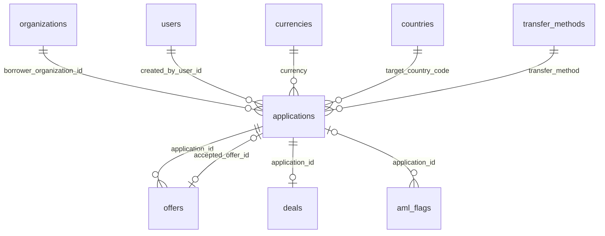

# `applications`

Заявка заёмщика на финансирование. Проходит модерацию, публикуется на витрине кредиторов, получает офферы.

- Группа: маркетплейс
- sqlc-модель: `repository.Application`
- API: `/applications`, `/applications/{id}`, `submit`, `cancel`, модерация админом, витрина кредитора

## Поля

| Поле | Тип | NULL | По умолчанию | Go (sqlc) | Описание |
|---|---|---|---|---|---|
| `id` | `uuid` PK | нет | `gen_random_uuid()` | `uuid.UUID` | |
| `number` | `bigint` identity UNIQUE | нет | авто | `pgtype.Int8` | Человекочитаемый номер, фронт показывает `APP-%06d` |
| `borrower_organization_id` | `uuid` FK → `organizations.id` | нет | — | `uuid.UUID` | Компания-заёмщик |
| `created_by_user_id` | `uuid` FK → `users.id` | нет | — | `uuid.UUID` | Автор |
| `status` | `application_status` | нет | `'draft'` | `ApplicationStatus` | `draft`, `moderation`, `rejected`, `published`, `agreed`, `cancelled` |
| `amount` | `numeric(17,2)` | нет | — | `decimal.Decimal` | `> 0` |
| `currency` | `char(3)` FK → `currencies.code` | нет | — | `string` | |
| `target_country_code` | `char(2)` FK → `countries.code` | нет | — | `string` | Откуда хотят получить деньги |
| `purpose` | `text` | нет | — | `string` | Цель, 10–2000 символов |
| `term_months` | `integer` | нет | — | `int32` | 1–120 |
| `transfer_method` | `text` FK → `transfer_methods.code` | нет | — | `string` | |
| `transfer_method_comment` | `text` | да | — | `pgtype.Text` | ≤ 500 |
| `moderation_comment` | `text` | да | — | `pgtype.Text` | Причина отклонения модератором |
| `accepted_offer_id` | `uuid` FK → `offers.id` | да | — | `pgtype.UUID` | Принятый оффер. FK добавлен через `ALTER TABLE` (цикл с `offers`) |
| `submitted_at` | `timestamptz` | да | — | `pgtype.Timestamptz` | Отправлена на модерацию |
| `published_at` | `timestamptz` | да | — | `pgtype.Timestamptz` | Опубликована |
| `created_at` | `timestamptz` | нет | `now()` | `pgtype.Timestamptz` | |
| `updated_at` | `timestamptz` | нет | `now()` | `pgtype.Timestamptz` | Триггер `applications_updated_at` |

`number` в Go — `pgtype.Int8`, потому что sqlc считает identity-колонку nullable. Фактически значение всегда есть.

## Ограничения и индексы

| Имя | Что проверяет |
|---|---|
| `applications_agreed_chk` | `status = agreed` ⇔ `accepted_offer_id IS NOT NULL` |
| `applications_accepted_offer_fk` | `accepted_offer_id` → `offers.id` |
| `applications_showcase_idx` | `(target_country_code, currency, amount) WHERE status = 'published'` — витрина |
| `applications_status_created_idx` | `(status, created_at DESC)` — очередь модерации |
| `applications_borrower_idx` | `(borrower_organization_id, created_at DESC)` — «мои заявки» |

## Связи

- Ссылается на: [`organizations`](organizations.md), [`users`](users.md), [`currencies`](currencies.md), [`countries`](countries.md), [`transfer_methods`](transfer_methods.md), [`offers`](offers.md) (`accepted_offer_id`).
- На неё ссылаются: [`offers`](offers.md), [`deals`](deals.md) (UNIQUE — не больше одной сделки), [`aml_flags`](aml_flags.md) (CASCADE).
- Полиморфно: [`status_history`](status_history.md) — история статусов заявки.

## sqlc-запросы (`queries/applications.sql`)

| Запрос | Тип | Что делает |
|---|---|---|
| `CreateApplication` | `:one` | Новая заявка в статусе `draft` |
| `GetApplicationVisible` | `:one` | Заявка по `id`, если её видит `viewer_role`/`viewer_org`. Видимость: `borrower` — заявки своей компании, `lender` — `published` и заявки со своим оффером, `admin` — все. Чужая и несуществующая одинаково → 0 строк → `404` |
| `LockApplicationByOfferForBorrower` | `:one` | `SELECT … FOR UPDATE OF a` заявки по `offer_id`, если она компании заёмщика (иначе 0 строк → 404). Статус не фильтруется — его проверяет сервис (409). Первый шаг транзакции принятия оффера |
| `UpdateApplication` | `:one` | Частичное обновление полей (`COALESCE`) |
| `SubmitApplication` | `:one` | → `moderation`, ставит `submitted_at`, очищает `moderation_comment` |
| `ApproveApplication` | `:one` | → `published`, ставит `published_at` |
| `RejectApplication` | `:one` | → `rejected` с `moderation_comment` |
| `CancelApplication` | `:one` | → `cancelled` |
| `AgreeApplication` | `:one` | → `agreed`, записывает `accepted_offer_id` |
| `ListApplicationsVisible` | `:many` | Список с тем же правилом видимости, что `GetApplicationVisible` (обязательные `viewer_role`, `viewer_org`), и фильтрами `statuses[]`, страна, валюта, сумма и срок от/до. Сортировка `sort_by`: `amount_asc/desc`, `term_asc/desc`, `created_at_asc`, по умолчанию `created_at DESC` |
| `CountApplicationsVisible` | `:one` | Счётчик для того же фильтра; блок видимости совпадает с `List` символ в символ |

`CreateStatusHistory` тоже лежит в `applications.sql`, но относится к [`status_history`](status_history.md).

Замечания:
- `UPDATE` пока работают по одному `id`, без `organization_id`: фильтр владельца в `WHERE` добавляет BE-07.
- В `UPDATE`-запросах нет условия по текущему статусу: допустимость перехода проверяет сервис.
- `ListApplicationsVisible` для витрины не джойнит `organizations` (имя и страну заёмщика) и не возвращает `my_offer_id`. Их придётся догружать отдельно или расширить запрос.
- Сортировка по умолчанию — `created_at`, а не `published_at`, как в примере витрины.
