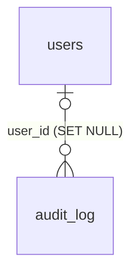

# `audit_log`

Журнал действий: логин, неудачный логин, загрузка документа, решения админа и т. д. Только INSERT: у роли приложения `lp_app` нет UPDATE, DELETE и TRUNCATE (миграция `00006_app_role_grants.sql`).

- Группа: служебные
- sqlc-модель: `repository.AuditLog`
- API: `GET /admin/audit-log`

## Поля

| Поле | Тип | NULL | По умолчанию | Go (sqlc) | Описание |
|---|---|---|---|---|---|
| `id` | `bigint` identity PK | нет | — | `int64` | |
| `user_id` | `uuid` FK → `users.id` ON DELETE SET NULL | да | — | `pgtype.UUID` | NULL — аноним (например, неудачный логин) |
| `action` | `text` | нет | — | `string` | `offer.accept`, `auth.login_failed` … |
| `entity_type` | `entity_type` | да | — | `NullEntityType` | |
| `entity_id` | `text` | да | — | `pgtype.Text` | |
| `ip` | `inet` | да | — | `*netip.Addr` | |
| `user_agent` | `text` | да | — | `pgtype.Text` | |
| `meta` | `jsonb` | нет | `'{}'` | `[]byte` | Детали действия |
| `created_at` | `timestamptz` | нет | `now()` | `pgtype.Timestamptz` | |

## Ограничения и индексы

- `audit_log_created_idx (created_at DESC)`.
- `audit_log_user_idx (user_id, created_at DESC)`.
- `audit_log_entity_idx (entity_type, entity_id)`.

## Связи

- Ссылается на: [`users`](users.md) (необязательно).
- Полиморфно через `entity_type` + `entity_id` — на любую сущность, без FK.

## sqlc-запросы (`queries/admin.sql`)

| Запрос | Тип | Что делает |
|---|---|---|
| `CreateAuditLog` | `:one` | Записать действие |
| `ListAuditLog` | `:many` | Страница журнала, `created_at DESC, id DESC`; фильтры `user_id`, `action`, `entity_type`, `entity_id`, период `[created_from, created_to)` — все `narg`, `NULL` = без фильтра |
| `CountAuditLog` | `:one` | `total` для `ListAuditLog` с теми же фильтрами |
