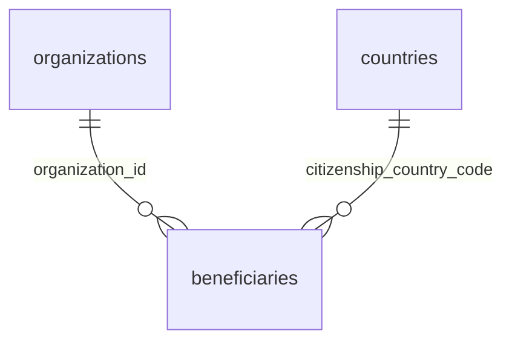

# `beneficiaries`

Конечные бенефициары компании, данные для KYC из `PATCH /organizations/me`. Список обновляется заменой целиком: delete + insert в одной транзакции.

- Группа: организации и пользователи
- sqlc-модель: `repository.Beneficiary`
- API: `GET/PATCH /organizations/me` (поле `beneficiaries`)

## Поля

| Поле | Тип | NULL | По умолчанию | Go (sqlc) | Описание |
|---|---|---|---|---|---|
| `id` | `uuid` PK | нет | `gen_random_uuid()` | `uuid.UUID` | |
| `organization_id` | `uuid` FK → `organizations.id` ON DELETE CASCADE | нет | — | `uuid.UUID` | Компания |
| `full_name` | `text` | нет | — | `string` | ФИО, 1–300 символов |
| `citizenship_country_code` | `char(2)` FK → `countries.code` | нет | — | `string` | Гражданство |
| `ownership_percent` | `numeric(7,4)` | нет | — | `decimal.Decimal` | Доля владения, `(0; 100]` |
| `created_at` | `timestamptz` | нет | `now()` | `pgtype.Timestamptz` | |

## Ограничения и индексы

- `CHECK (ownership_percent > 0 AND ownership_percent <= 100)`.
- `beneficiaries_org_idx (organization_id)`.
- Сумма долей ≤ 100 % в БД не проверяется — это правило сервиса.

## Связи

- Ссылается на: [`organizations`](organizations.md), [`countries`](countries.md).

## sqlc-запросы

**Нет.** Таблица заполняется только демо-сидом `testdata/seed_demo.sql`. Для `PATCH /organizations/me` нужно добавить в `queries/organizations.sql` (или отдельный `beneficiaries.sql`):

- `ListBeneficiariesByOrg :many`
- `DeleteBeneficiariesByOrg :exec`
- `CreateBeneficiary :one` (или `:copyfrom` для пакетной вставки)
