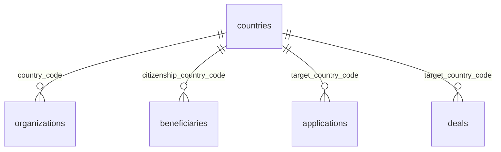

# `countries`

Справочник стран: ISO 3166-1 alpha-2, отметки FATF и «недружественности». Заполняется сидом `00002_seed_dictionaries.sql`.

- Группа: справочники
- sqlc-модель: `repository.Country`
- API: `GET /dictionaries/countries`

## Поля

| Поле | Тип | NULL | По умолчанию | Go (sqlc) | Описание |
|---|---|---|---|---|---|
| `code` | `char(2)` PK | нет | — | `string` | ISO 3166-1 alpha-2, `CHECK (code ~ '^[A-Z]{2}$')` |
| `name_ru` | `text` | нет | — | `string` | Название на русском |
| `name_en` | `text` | нет | — | `string` | Название на английском |
| `fatf_list` | `fatf_list` (`black` / `grey`) | да | — | `NullFatfList` | NULL — страны нет в списках FATF |
| `fatf_as_of` | `date` | да | — | `pgtype.Date` | Дата пленара FATF, на которую актуален список |
| `is_unfriendly` | `boolean` | нет | `false` | `bool` | В перечне недружественных стран РФ |

## Связи

- На неё ссылаются: [`organizations`](organizations.md), [`beneficiaries`](beneficiaries.md), [`applications`](applications.md), [`deals`](deals.md).
- `sanctions_entries.country_code` — тоже код страны, но **без FK**: санкционные списки могут содержать коды, которых нет в справочнике.

## sqlc-запросы (`queries/dictionaries.sql`)

| Запрос | Тип | Что делает |
|---|---|---|
| `ListCountries` | `:many` | `code, name_ru, name_en` + вычисляемое `fatf_high_risk = fatf_list IS NOT NULL`, сортировка по `name_ru` |

`fatf_list`, `fatf_as_of` и `is_unfriendly` наружу не отдаются, их читает только AML-скрининг (запроса для него пока нет).
