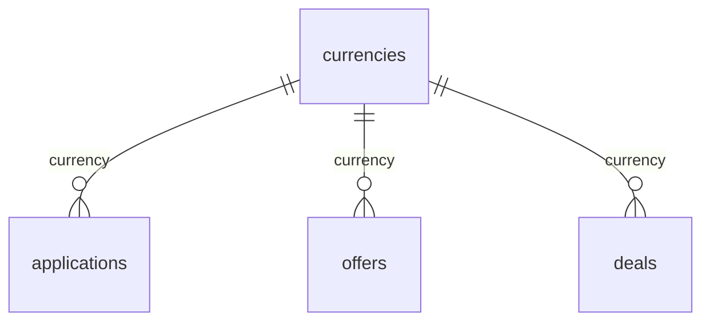

# `currencies`

Справочник валют ISO 4217. Заполняется сидом `00002_seed_dictionaries.sql`.

- Группа: справочники
- sqlc-модель: `repository.Currency`
- API: `GET /dictionaries/currencies`

## Поля

| Поле | Тип | NULL | По умолчанию | Go (sqlc) | Описание |
|---|---|---|---|---|---|
| `code` | `char(3)` PK | нет | — | `string` | ISO 4217, `CHECK (code ~ '^[A-Z]{3}$')` |
| `name` | `text` | нет | — | `string` | Название валюты |
| `minor_units` | `smallint` | нет | `2` | `int16` | Число знаков после запятой |

## Связи

- На неё ссылаются: [`applications`](applications.md), [`offers`](offers.md), [`deals`](deals.md).

## sqlc-запросы (`queries/dictionaries.sql`)

| Запрос | Тип | Что делает |
|---|---|---|
| `ListCurrencies` | `:many` | `code, name`, сортировка по `code` |

`minor_units` наружу не отдаётся. Деньги в БД всё равно хранятся как `numeric(17,2)`.
