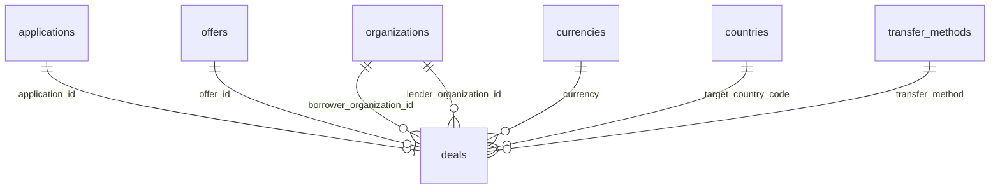

# `deals`

Неизменяемый снапшот условий на момент принятия оффера. После создания не меняется.

- Группа: маркетплейс
- sqlc-модель: `repository.Deal`
- API: `GET /deals`, `GET /deals/{id}`

## Поля

| Поле | Тип | NULL | По умолчанию | Go (sqlc) | Описание |
|---|---|---|---|---|---|
| `id` | `uuid` PK | нет | `gen_random_uuid()` | `uuid.UUID` | |
| `number` | `bigint` identity UNIQUE | нет | авто | `pgtype.Int8` | Показывается как `DEAL-%06d` |
| `application_id` | `uuid` FK → `applications.id`, UNIQUE | нет | — | `uuid.UUID` | Одна сделка на заявку |
| `offer_id` | `uuid` FK → `offers.id`, UNIQUE | нет | — | `uuid.UUID` | Одна сделка на оффер |
| `borrower_organization_id` | `uuid` FK → `organizations.id` | нет | — | `uuid.UUID` | Денормализовано из заявки |
| `lender_organization_id` | `uuid` FK → `organizations.id` | нет | — | `uuid.UUID` | Денормализовано из оффера |
| `amount` | `numeric(17,2)` | нет | — | `decimal.Decimal` | `> 0` |
| `currency` | `char(3)` FK → `currencies.code` | нет | — | `string` | |
| `interest_rate_annual` | `numeric(7,4)` | нет | — | `decimal.Decimal` | |
| `fee_percent` | `numeric(7,4)` | да | — | `decimal.NullDecimal` | |
| `fee_amount` | `numeric(17,2)` | да | — | `decimal.NullDecimal` | `round(amount × fee_percent / 100, 2)` |
| `term_months` | `integer` | нет | — | `int32` | Из заявки |
| `target_country_code` | `char(2)` FK → `countries.code` | нет | — | `string` | Из заявки |
| `transfer_method` | `text` FK → `transfer_methods.code` | нет | — | `string` | Из заявки |
| `repayment_schedule` | `repayment_schedule` | нет | — | `RepaymentSchedule` | Из оффера |
| `collateral` | `text` | да | — | `pgtype.Text` | Из оффера |
| `additional_terms` | `text` | да | — | `pgtype.Text` | Из оффера |
| `agreed_at` | `timestamptz` | нет | `now()` | `pgtype.Timestamptz` | |

## Ограничения и индексы

| Имя | Что проверяет |
|---|---|
| `deals_parties_chk` | Заёмщик ≠ кредитор |
| `deals_fee_chk` | `fee_percent` и `fee_amount` либо оба заданы, либо оба NULL |
| `UNIQUE (application_id)`, `UNIQUE (offer_id)` | Одна сделка на заявку и на оффер |
| `deals_borrower_idx`, `deals_lender_idx` | `(…_organization_id, agreed_at DESC)` — списки сделок сторон |

## Связи

- Ссылается на: [`applications`](applications.md), [`offers`](offers.md), [`organizations`](organizations.md) (дважды), [`currencies`](currencies.md), [`countries`](countries.md), [`transfer_methods`](transfer_methods.md).

## sqlc-запросы (`queries/deals.sql`)

| Запрос | Тип | Что делает |
|---|---|---|
| `CreateDeal` | `:one` | Снапшот условий. `fee_amount` считается в SQL: `round($amount × $fee_percent / 100, 2)` |
| `GetDealByID` | `:one` | Сделка по `id` |
| `ListDeals` | `:many` | Фильтр по `borrower_org_id` или `lender_org_id`, сортировка `agreed_at DESC`, пагинация |
| `CountDeals` | `:one` | Счётчик для того же фильтра |

Замечания:
- `GetDealByID` не фильтрует по стороне сделки: проверка, что пользователь — заёмщик или кредитор, в сервисе.
- `fee_amount` в `CreateDeal` считается в SQL, а в [schema.md](../schema.md) написано, что его считает бэкенд. Результат тот же, но источник правды теперь — запрос.
