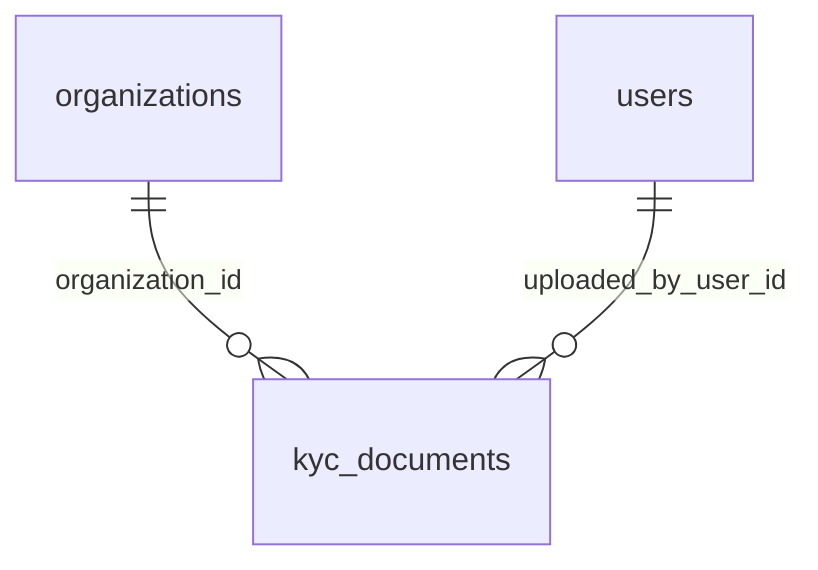

# `kyc_documents`

Метаданные KYC-файлов. Сам файл лежит на диске или в S3 под `storage_key` (случайное имя) вне веб-корня.

- Группа: KYC
- sqlc-модель: `repository.KycDocument`
- API: `POST/GET/DELETE /organizations/me/documents`, просмотр документов админом

## Поля

| Поле | Тип | NULL | По умолчанию | Go (sqlc) | Описание |
|---|---|---|---|---|---|
| `id` | `uuid` PK | нет | `gen_random_uuid()` | `uuid.UUID` | |
| `organization_id` | `uuid` FK → `organizations.id` ON DELETE CASCADE | нет | — | `uuid.UUID` | Владелец документа |
| `doc_type` | `kyc_document_type` | нет | — | `KycDocumentType` | `charter`, `registration_certificate`, `address_proof`, `beneficiaries_register`, `source_of_funds`, `other` |
| `storage_key` | `text` UNIQUE | нет | — | `string` | Ключ в хранилище (случайное имя) |
| `file_name` | `text` | нет | — | `string` | Оригинальное имя, только для показа, ≤ 255 |
| `mime_type` | `text` | нет | — | `string` | Только `application/pdf`, `image/png`, `image/jpeg` |
| `size_bytes` | `bigint` | нет | — | `int64` | `(0; 10 MB]` |
| `sha256` | `bytea` | нет | — | `[]byte` | Хеш содержимого, 32 байта |
| `uploaded_by_user_id` | `uuid` FK → `users.id` | нет | — | `uuid.UUID` | Кто загрузил |
| `uploaded_at` | `timestamptz` | нет | `now()` | `pgtype.Timestamptz` | |

## Ограничения и индексы

- CHECK на `mime_type`, `size_bytes`, длину `sha256` и `file_name`. Это вторая линия защиты: MIME и размер сервис проверяет по содержимому.
- `kyc_documents_org_idx (organization_id, doc_type)`.

## Связи

- Ссылается на: [`organizations`](organizations.md), [`users`](users.md).

## sqlc-запросы (`queries/kyc.sql`)

| Запрос | Тип | Что делает |
|---|---|---|
| `CreateKycDocument` | `:one` | Запись метаданных после сохранения файла |
| `ListKycDocumentsByOrg` | `:many` | Все документы компании, `ORDER BY uploaded_at, id` |
| `GetKycDocumentVisible` | `:one` | Документ для скачивания: admin — любой, остальные — своей организации; чужой → 0 строк → `404` |
| `DeleteKycDocument` | `:one` | Удаление по `id` **и** `organization_id` (IDOR), `RETURNING storage_key` — чтобы удалить файл после коммита |
