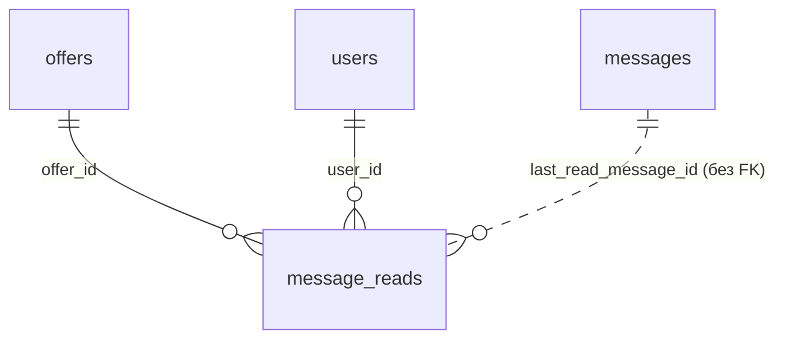

# `message_reads`

Указатель «прочитано до» для каждого пользователя в каждом чате. По нему считается `unread_messages`.

- Группа: маркетплейс (чат)
- sqlc-модель: `repository.MessageRead`
- API: `POST /offers/{id}/messages/read`, поле `unread_messages` в офферах

## Поля

| Поле | Тип | NULL | По умолчанию | Go (sqlc) | Описание |
|---|---|---|---|---|---|
| `offer_id` | `uuid` PK, FK → `offers.id` ON DELETE CASCADE | нет | — | `uuid.UUID` | Чат |
| `user_id` | `uuid` PK, FK → `users.id` ON DELETE CASCADE | нет | — | `uuid.UUID` | Читатель |
| `last_read_message_id` | `bigint` | нет | — | `int64` | `messages.id` последнего прочитанного (без FK) |

## Ограничения и индексы

- `PRIMARY KEY (offer_id, user_id)`.

## Связи

- Ссылается на: [`offers`](offers.md), [`users`](users.md); логически на [`messages`](messages.md).

## sqlc-запросы (`queries/chat.sql`)

| Запрос | Тип | Что делает |
|---|---|---|
| `MarkMessagesRead` | `:exec` | Upsert указателя. Через `GREATEST` указатель только растёт, назад не откатывается. Доступ не проверяет — вызывается после `GetOfferVisible` |

Указатель читает подзапрос `unread_messages` в `*OffersVisible` (см. [`offers`](offers.md)).
