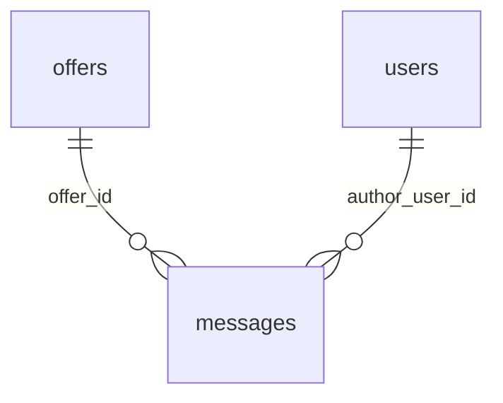

# `messages`

Сообщения чата по офферу. Клиент опрашивает новые сообщения через polling по `id > after_id`.

- Группа: маркетплейс (чат)
- sqlc-модель: `repository.Message`
- API: `GET/POST /offers/{id}/messages`

## Поля

| Поле | Тип | NULL | По умолчанию | Go (sqlc) | Описание |
|---|---|---|---|---|---|
| `id` | `bigint` identity PK | нет | — | `int64` | Монотонный, используется как курсор |
| `offer_id` | `uuid` FK → `offers.id` | нет | — | `uuid.UUID` | Чат = оффер |
| `author_user_id` | `uuid` FK → `users.id` | нет | — | `uuid.UUID` | Автор |
| `text` | `text` | нет | — | `string` | Plain text без HTML, 1–4000 символов |
| `created_at` | `timestamptz` | нет | `now()` | `pgtype.Timestamptz` | |

## Ограничения и индексы

- `messages_offer_idx (offer_id, id)` — под `WHERE offer_id = $1 AND id > $after`.

## Связи

- Ссылается на: [`offers`](offers.md), [`users`](users.md).
- Логически связана с [`message_reads`](message_reads.md): `last_read_message_id` указывает на `messages.id` (без FK).

## sqlc-запросы (`queries/chat.sql`)

| Запрос | Тип | Что делает |
|---|---|---|
| `LockOfferChat` | `:exec` | `pg_advisory_xact_lock` на чат оффера перед `CreateMessage` |
| `CreateMessage` | `:one` | Отправка сообщения |
| `ListMessagesVisible` | `:many` | Сообщения оффера с `id > after_id`, по возрастанию, с лимитом; с ролью и компанией автора. Правило видимости оффера — в `WHERE` (`viewer_role`/`viewer_org`), как у `*OffersVisible` |

Замечания:
- Непрочитанные (чужие сообщения после указателя из `message_reads`) считает подзапрос `unread_messages` в `GetOfferVisible`, `ListOffersVisible`, `ListApplicationOffersVisible` ([`offers`](offers.md)).
- `ListMessagesVisible` с `after_id = 0` возвращает **первые** (самые старые) сообщения. Для «последних N» нужен отдельный запрос с `ORDER BY id DESC` — в MVP не делаем (DECISIONS п. 15).
- `id` из IDENTITY выдаётся до коммита, поэтому без блокировки сообщение с меньшим `id` может закоммититься позже большего, и polling по `id > after_id` его пропустит. `LockOfferChat` в транзакции отправки упорядочивает коммиты сообщений одного оффера по `id`.
- `CreateMessage` не проверяет доступ: сервис сначала читает оффер через `GetOfferVisible` в той же транзакции.
