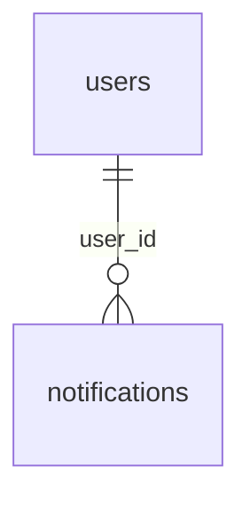

# `notifications`

Внутренние уведомления пользователей. Пишутся в той же транзакции, что и событие, без брокера.

- Группа: служебные
- sqlc-модель: `repository.Notification`
- API: `GET /notifications`, `POST /notifications/{id}/read`, `POST /notifications/read-all`

## Поля

| Поле | Тип | NULL | По умолчанию | Go (sqlc) | Описание |
|---|---|---|---|---|---|
| `id` | `bigint` identity PK | нет | — | `int64` | |
| `user_id` | `uuid` FK → `users.id` ON DELETE CASCADE | нет | — | `uuid.UUID` | Получатель |
| `type` | `notification_type` | нет | — | `NotificationType` | `kyc_*`, `application_*`, `offer_*`, `message_received`, `aml_flag_created` |
| `title` | `text` | нет | — | `string` | Текст уведомления |
| `entity_type` | `entity_type` | нет | — | `EntityType` | На что ведёт уведомление |
| `entity_id` | `text` | нет | — | `string` | `id` сущности (text, т. к. бывают и uuid, и bigint) |
| `is_read` | `boolean` | нет | `false` | `bool` | |
| `created_at` | `timestamptz` | нет | `now()` | `pgtype.Timestamptz` | |

## Ограничения и индексы

- `notifications_feed_idx (user_id, created_at DESC, id DESC)` — лента: порядок с тай-брейком по `id` берётся из индекса без досортировки (миграция `00003`).
- `notifications_unread_idx (user_id) WHERE NOT is_read` — счётчик непрочитанных.

## Связи

- Ссылается на: [`users`](users.md).
- Полиморфно через `entity_type` + `entity_id` — на любую сущность (заявку, оффер, документ…), без FK.

## sqlc-запросы (`queries/notifications.sql`)

| Запрос | Тип | Что делает |
|---|---|---|
| `CreateNotification` | `:one` | Создать уведомление |
| `CreateNotificationsForAdmins` | `:execrows` | Уведомление всем активным админам |
| `CreateNotificationsForOrganization` | `:execrows` | Уведомление всем активным пользователям компании |
| `ListNotifications` | `:many` | Лента пользователя, опционально `unread_only`, пагинация; `created_at DESC, id DESC` |
| `CountNotifications` | `:one` | `total` и `unread` одним запросом; сервис читает его в одном снимке с `ListNotifications` |
| `MarkNotificationRead` | `:execrows` | Отметить одно; фильтр по `id` **и** `user_id` — защита от IDOR |
| `MarkAllNotificationsRead` | `:exec` | Отметить все уведомления пользователя |
