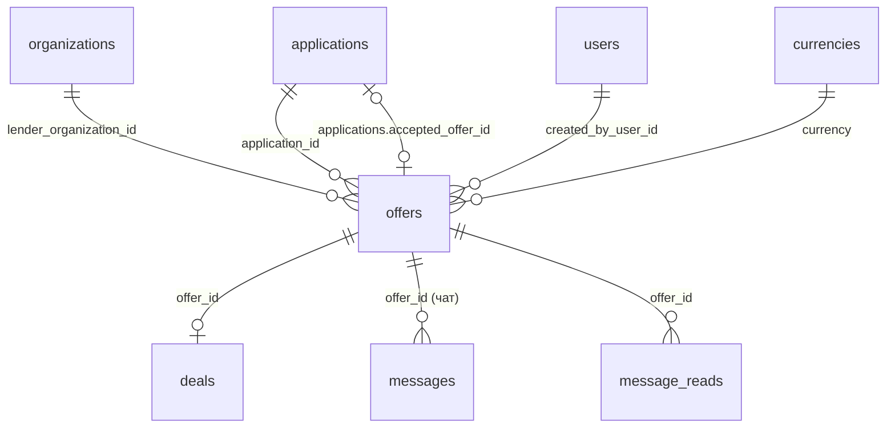

# `offers`

Предложение кредитора по заявке. Чат привязан к офферу, то есть к паре «заёмщик ↔ кредитор» по конкретной заявке.

- Группа: маркетплейс
- sqlc-модель: `repository.Offer`
- API: `POST /applications/{id}/offers`, `GET /offers`, `POST /offers/{id}/accept|reject|withdraw`

## Поля

| Поле | Тип | NULL | По умолчанию | Go (sqlc) | Описание |
|---|---|---|---|---|---|
| `id` | `uuid` PK | нет | `gen_random_uuid()` | `uuid.UUID` | |
| `application_id` | `uuid` FK → `applications.id` | нет | — | `uuid.UUID` | Заявка |
| `lender_organization_id` | `uuid` FK → `organizations.id` | нет | — | `uuid.UUID` | Компания-кредитор |
| `created_by_user_id` | `uuid` FK → `users.id` | нет | — | `uuid.UUID` | Автор |
| `status` | `offer_status` (`sent` / `accepted` / `rejected` / `withdrawn`) | нет | `'sent'` | `OfferStatus` | |
| `reject_reason` | `offer_reject_reason` | да | — | `NullOfferRejectReason` | `rejected_by_borrower`, `another_offer_accepted`, `application_cancelled` |
| `reject_comment` | `text` | да | — | `pgtype.Text` | ≤ 1000 |
| `amount` | `numeric(17,2)` | нет | — | `decimal.Decimal` | `> 0`; ≤ суммы заявки проверяет сервис |
| `currency` | `char(3)` FK → `currencies.code` | нет | — | `string` | = валюте заявки, проверяет сервис |
| `interest_rate_annual` | `numeric(7,4)` | нет | — | `decimal.Decimal` | Годовая ставка, `[0; 1000]` |
| `fee_percent` | `numeric(7,4)` | да | — | `decimal.NullDecimal` | Комиссия, `[0; 100]` |
| `repayment_schedule` | `repayment_schedule` | нет | — | `RepaymentSchedule` | `bullet`, `annuity`, `interest_monthly_principal_bullet`, `custom` |
| `collateral` | `text` | да | — | `pgtype.Text` | Обеспечение, ≤ 2000 |
| `additional_terms` | `text` | да | — | `pgtype.Text` | ≤ 4000 |
| `valid_until` | `timestamptz` | да | — | `pgtype.Timestamptz` | Срок действия оффера |
| `created_at` | `timestamptz` | нет | `now()` | `pgtype.Timestamptz` | |
| `decided_at` | `timestamptz` | да | — | `pgtype.Timestamptz` | Когда вышел из `sent` |

## Ограничения и индексы

| Имя | Что проверяет |
|---|---|
| `offers_reject_reason_chk` | `status = rejected` ⇔ `reject_reason IS NOT NULL` |
| `offers_decided_chk` | `status = sent` ⇔ `decided_at IS NULL` |
| `offers_one_active_per_lender_uq` | Не больше одного `sent`-оффера компании на заявку |
| `offers_one_accepted_uq` | Не больше одного `accepted`-оффера на заявку (страховка от гонки) |
| `offers_application_idx` | `(application_id, status)` |
| `offers_lender_idx` | `(lender_organization_id, created_at DESC)` — «мои офферы» |

## Связи

- Ссылается на: [`applications`](applications.md), [`organizations`](organizations.md), [`users`](users.md), [`currencies`](currencies.md).
- На неё ссылаются: [`applications`](applications.md) (`accepted_offer_id`), [`deals`](deals.md) (UNIQUE), [`messages`](messages.md), [`message_reads`](message_reads.md) (CASCADE).
- Полиморфно: [`status_history`](status_history.md), [`notifications`](notifications.md).

## sqlc-запросы (`queries/offers.sql`)

| Запрос | Тип | Что делает |
|---|---|---|
| `CreateOffer` | `:one` | Новый оффер в статусе `sent` |
| `GetOfferVisible` | `:one` | Оффер по `id`, если его видит `viewer_role`/`viewer_org`: `lender` — свой, `borrower` — на свою заявку, `admin` — любой. Чужой и несуществующий → 0 строк → `404` |
| `ListOffersByApplication` | `:many` | Офферы заявки, опционально по `statuses[]` (для заёмщика) |
| `ListOffersVisible` | `:many` | То же правило видимости (обязательные `viewer_role`, `viewer_org`), фильтры `application_id`, `statuses[]`, пагинация |
| `CountOffersVisible` | `:one` | Счётчик для того же фильтра |
| `AcceptOffer` | `:one` | `sent` → `accepted`. 0 строк = оффер уже не активен (409) |
| `RejectOtherOffers` | `:exec` | Остальные `sent`-офферы заявки → `rejected` (`another_offer_accepted`) |
| `RejectOffer` | `:one` | Заёмщик отклоняет: → `rejected` (`rejected_by_borrower`) с комментарием |
| `WithdrawOffer` | `:one` | Кредитор отзывает: → `withdrawn` |
| `RejectAllOffersForApplication` | `:exec` | При отмене заявки все `sent` → `rejected` (`application_cancelled`) |

Все переходы стоят с `AND status = 'sent'` в `WHERE`, поэтому повторное действие вернёт 0 строк, а не испортит данные.

Порядок транзакции принятия: `GetApplicationForUpdate` → `AcceptOffer` → `RejectOtherOffers` → `AgreeApplication` → `CreateDeal` → `CreateStatusHistory` → `CreateNotification` → `CreateAuditLog`.

Замечания:
- `RejectOtherOffers` и `RejectAllOffersForApplication` — `:exec`, они не возвращают `id, lender_organization_id` отклонённых офферов. Чтобы отправить кредиторам уведомления, нужно сделать их `:many` с `RETURNING`.
- `ListOffersByApplication` пока не фильтрует по организации: видимость (заёмщик-владелец и admin — все, кредитор — только свой) добавляет BE-08.
