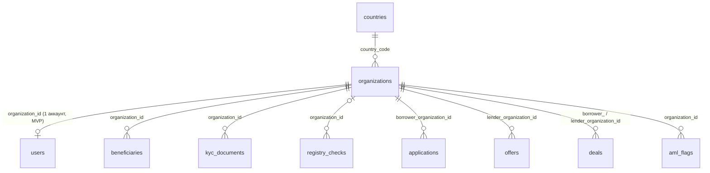

# `organizations`

Юрлицо — заёмщик или кредитор. Проходит KYC, статус `kyc_status` хранится здесь, а не у пользователя.

- Группа: организации и пользователи
- sqlc-модель: `repository.Organization`
- API: `POST /auth/register`, `GET/PATCH /organizations/me`, `POST /organizations/me/kyc/submit`, `GET /admin/organizations`, решения админа по KYC

## Поля

| Поле | Тип | NULL | По умолчанию | Go (sqlc) | Описание |
|---|---|---|---|---|---|
| `id` | `uuid` PK | нет | `gen_random_uuid()` | `uuid.UUID` | |
| `type` | `organization_type` (`borrower` / `lender`) | нет | — | `OrganizationType` | Роль компании на площадке |
| `name` | `text` | нет | — | `string` | 2–300 символов |
| `country_code` | `char(2)` FK → `countries.code` | нет | — | `string` | Страна регистрации |
| `registration_number` | `text` | нет | — | `string` | ИНН для RU, рег. номер для остальных; 1–50 символов |
| `lei` | `char(20)` | да | — | `pgtype.Text` | Legal Entity Identifier, `^[A-Z0-9]{20}$` |
| `legal_address` | `text` | нет | — | `string` | ≤ 1000 символов |
| `kyc_status` | `kyc_status` (`draft` / `under_review` / `verified` / `rejected`) | нет | `'draft'` | `KycStatus` | |
| `kyc_reject_reason` | `text` | да | — | `pgtype.Text` | Причина отказа в KYC |
| `kyc_submitted_at` | `timestamptz` | да | — | `pgtype.Timestamptz` | Когда отправлена на проверку |
| `verified_at` | `timestamptz` | да | — | `pgtype.Timestamptz` | Заполнено ⇔ `kyc_status = verified` |
| `created_at` | `timestamptz` | нет | `now()` | `pgtype.Timestamptz` | |
| `updated_at` | `timestamptz` | нет | `now()` | `pgtype.Timestamptz` | Обновляет триггер `organizations_updated_at` |

## Ограничения и индексы

| Имя | Что проверяет |
|---|---|
| `organizations_type_country_chk` | Заёмщик только из `RU`, кредитор только не из `RU` |
| `organizations_verified_chk` | `kyc_status = verified` ⇔ `verified_at IS NOT NULL` |
| `organizations_regnum_uq` | `UNIQUE (country_code, registration_number)` |
| `organizations_lei_uq` | Уникальный LEI (частичный индекс, `WHERE lei IS NOT NULL`) |
| `organizations_kyc_status_idx` | `(kyc_status, created_at)` — очередь KYC у админа |

## Связи

- Ссылается на: [`countries`](countries.md).
- На неё ссылаются: [`users`](users.md) (RESTRICT), [`beneficiaries`](beneficiaries.md) (CASCADE), [`kyc_documents`](kyc_documents.md) (CASCADE), [`registry_checks`](registry_checks.md) (CASCADE), [`applications`](applications.md), [`offers`](offers.md), [`deals`](deals.md) (дважды: заёмщик и кредитор), [`aml_flags`](aml_flags.md) (CASCADE).
- Полиморфно: [`status_history`](status_history.md), [`audit_log`](audit_log.md), [`notifications`](notifications.md) с `entity_type = 'organization'`.

## sqlc-запросы (`queries/organizations.sql`)

| Запрос | Тип | Что делает |
|---|---|---|
| `CreateOrganization` | `:one` | Регистрация компании, `kyc_status = 'draft'` |
| `GetOrganizationByID` | `:one` | Карточка компании по `id` |
| `UpdateOrganization` | `:one` | Частичное обновление (`COALESCE` по `name`, `registration_number`, `legal_address`, `lei`) |
| `SubmitKycForReview` | `:one` | → `under_review`, ставит `kyc_submitted_at`, сбрасывает причину отказа |
| `ApproveKyc` | `:one` | → `verified`, ставит `verified_at` |
| `RejectKyc` | `:one` | → `rejected` с причиной, сбрасывает `verified_at` |
| `ListOrganizations` | `:many` | Админский список с фильтрами `kyc_status`, `type`, `country_code`, `q` (ILIKE по имени и рег. номеру), пагинация |
| `CountOrganizations` | `:one` | Счётчик для того же фильтра |

Замечания:
- В `UPDATE`-запросах KYC нет условия по текущему статусу в `WHERE`: допустимость перехода проверяет сервис. Двойное одобрение одной заявки на KYC БД не остановит.
- `UpdateOrganization` через `COALESCE` не умеет обнулить `lei`.
- `country_code` и `type` не меняются после регистрации: в `UpdateOrganization` их нет.
