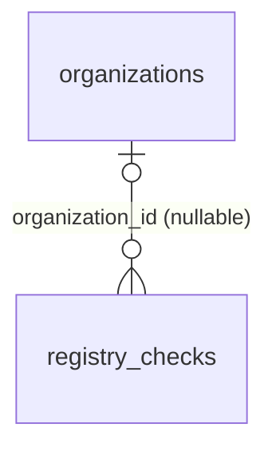

# `registry_checks`

Снапшоты ответов внешних реестров: ЕГРЮЛ через DaData, GLEIF или мок. Это доказательная база проверки, админ видит её в `GET /admin/organizations/{id}` (поле `registry_check`).

- Группа: KYC
- sqlc-модель: `repository.RegistryCheck`
- API: lookup по ИНН/LEI при регистрации, `GET /admin/organizations/{id}`

## Поля

| Поле | Тип | NULL | По умолчанию | Go (sqlc) | Описание |
|---|---|---|---|---|---|
| `id` | `bigint` identity PK | нет | — | `int64` | |
| `organization_id` | `uuid` FK → `organizations.id` ON DELETE CASCADE | да | — | `pgtype.UUID` | NULL для lookup до регистрации |
| `source` | `registry_source` (`egrul_dadata` / `gleif` / `mock`) | нет | — | `RegistrySource` | |
| `query` | `text` | нет | — | `string` | Что искали: ИНН или LEI |
| `found` | `boolean` | нет | — | `bool` | Нашлось ли |
| `name` | `text` | да | — | `pgtype.Text` | Название по реестру |
| `registration_number` | `text` | да | — | `pgtype.Text` | |
| `legal_address` | `text` | да | — | `pgtype.Text` | |
| `registry_status` | `text` | да | — | `pgtype.Text` | Статус в реестре (действующая, ликвидирована…) |
| `raw_response` | `jsonb` | да | — | `[]byte` | Сырой ответ |
| `checked_at` | `timestamptz` | нет | `now()` | `pgtype.Timestamptz` | |

## Ограничения и индексы

- `registry_checks_org_idx (organization_id, checked_at DESC)` — последняя проверка компании.

## Связи

- Ссылается на: [`organizations`](organizations.md) (необязательно).

## sqlc-запросы (`queries/kyc.sql`)

| Запрос | Тип | Что делает |
|---|---|---|
| `CreateRegistryCheck` | `:one` | Сохраняет снапшот ответа |
| `GetLatestRegistryCheck` | `:one` | Последняя проверка компании |

Нет запроса, который привязывает проверку, сделанную до регистрации (`organization_id IS NULL`), к созданной компании. Если такой сценарий нужен, добавить `AttachRegistryCheck :exec`.
