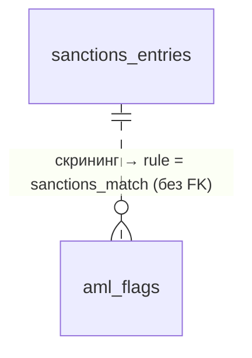

# `sanctions_entries`

Загруженные санкционные списки OFAC / EU / UN / UK (или мок). Обновляются загрузчиком, используются для нечёткого поиска при AML-скрининге.

- Группа: служебные (AML)
- sqlc-модель: `repository.SanctionsEntry`
- API: напрямую не отдаётся; результаты превращаются в [`aml_flags`](aml_flags.md)

## Поля

| Поле | Тип | NULL | По умолчанию | Go (sqlc) | Описание |
|---|---|---|---|---|---|
| `id` | `bigint` identity PK | нет | — | `int64` | |
| `source` | `text` | нет | — | `string` | `ofac_sdn`, `eu_fsf`, `un_sc`, `uk_fcdo`, `mock` … |
| `external_id` | `text` | нет | — | `string` | ID записи в исходном списке |
| `entity_kind` | `text` | нет | — | `string` | `organization`, `person`, `other` |
| `name` | `text` | нет | — | `string` | Имя как в списке |
| `name_normalized` | `text` | нет | — | `string` | Нижний регистр + транслит + без орг. форм + схлопнутые пробелы |
| `country_code` | `char(2)` | да | — | `pgtype.Text` | Без FK на `countries` |
| `raw` | `jsonb` | да | — | `[]byte` | Исходная запись |
| `loaded_at` | `timestamptz` | нет | `now()` | `pgtype.Timestamptz` | |

## Ограничения и индексы

- `UNIQUE (source, external_id, name_normalized)` — одна запись может иметь несколько написаний имени (алиасы).
- `sanctions_entries_name_trgm_idx` — GIN `gin_trgm_ops` по `name_normalized` для оператора `%`.

## Связи

Внешних ключей нет — таблица изолирована.

## sqlc-запросы

| Запрос | Файл | Тип | Что делает |
|---|---|---|---|
| `SearchSanctions` | `admin.sql` | `:many` | Кандидаты: `name_normalized % @query` и `similarity ≥ @min_similarity`, возвращает `trgm_score`, сортировка `trgm_score DESC, id`, лимит |
| `DeleteSanctionsBySource` | `sanctions.sql` | `:execrows` | Удалить все записи источника |
| `InsertSanctionsEntries` | `sanctions.sql` | `:copyfrom` | Залить записи источника (COPY) |

Замечания:
- Результат `SearchSanctions` не зависит от GUC `pg_trgm.similarity_threshold`, пока GUC ≤ 0.4 (`aml.candidateMinSimilarity`): `%` нужен только ради GIN-индекса, порог задаёт явное условие. GUC в коде не меняем. Проверяет `TestSearchSanctionsThresholdIndependent`.
- Финальный скоринг (Jaro-Winkler) — в Go, `internal/aml`.
- Загрузчик — `make load-sanctions` (`backend/cmd/loadsanctions`): мок-список (`internal/aml/sanctionslist/mock.json`, `source = 'mock'`) или UK Sanctions List CSV (`SANCTIONS_SOURCE=uk_fcdo SANCTIONS_FILE=…`). Источник заменяется атомарно: `DeleteSanctionsBySource` и `InsertSanctionsEntries` в одной транзакции; дубли `(external_id, name_normalized)` снимаются до вставки. Подключение — `MIGRATE_DATABASE_URL`, иначе `DATABASE_URL`: после DB-SEC у `lp_app` только `SELECT`.
- Поменял `aml.Normalize` — перезагрузи списки, иначе `name_normalized` в БД разойдётся с запросом.
