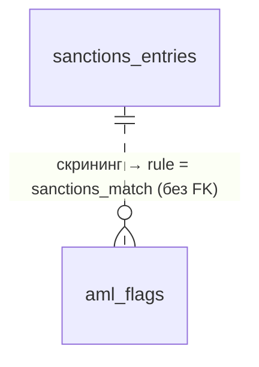

# `sanctions_entries`

Загруженные санкционные списки OFAC / EU / UN / UK (или мок). Обновляются загрузчиком, используются для нечёткого поиска при AML-скрининге.

- Группа: служебные (AML)
- sqlc-модель: `repository.SanctionsEntry`
- API: напрямую не отдаётся; результаты превращаются в [`aml_flags`](aml_flags.md)

## Поля

| Поле | Тип | NULL | По умолчанию | Go (sqlc) | Описание |
|---|---|---|---|---|---|
| `id` | `bigint` identity PK | нет | — | `int64` | |
| `source` | `text` | нет | — | `string` | `ofac_sdn`, `eu_fsf`, `un_sc`, `uk_fcdo`, `mock` … |
| `external_id` | `text` | нет | — | `string` | ID записи в исходном списке |
| `entity_kind` | `text` | нет | — | `string` | `organization`, `person`, `other` |
| `name` | `text` | нет | — | `string` | Имя как в списке |
| `name_normalized` | `text` | нет | — | `string` | Нижний регистр + транслит + без орг. форм + схлопнутые пробелы |
| `country_code` | `char(2)` | да | — | `pgtype.Text` | Без FK на `countries` |
| `raw` | `jsonb` | да | — | `[]byte` | Исходная запись |
| `loaded_at` | `timestamptz` | нет | `now()` | `pgtype.Timestamptz` | |

## Ограничения и индексы

- `UNIQUE (source, external_id, name_normalized)` — одна запись может иметь несколько написаний имени (алиасы).
- `sanctions_entries_name_trgm_idx` — GIN `gin_trgm_ops` по `name_normalized` для оператора `%`.

## Связи

Внешних ключей нет — таблица изолирована.

## sqlc-запросы (`queries/admin.sql`)

| Запрос | Тип | Что делает |
|---|---|---|
| `SearchSanctions` | `:many` | Кандидаты по `name_normalized % $1`, сортировка по `similarity` DESC, с лимитом |

Замечания:
- Перед `SearchSanctions` нужно выполнить `SET pg_trgm.similarity_threshold = 0.4` **на том же соединении** (лучше `SET LOCAL` в транзакции). Иначе действует порог по умолчанию 0.3, а через пул соединений настройка может не дойти до запроса.
- `similarity` не возвращается в результате, а он нужен для отладки и порога. Финальный скоринг (Jaro-Winkler) — в Go.
- Нет запросов для загрузчика списков: upsert записей и удаление устаревших (`:copyfrom` или `INSERT … ON CONFLICT`).
