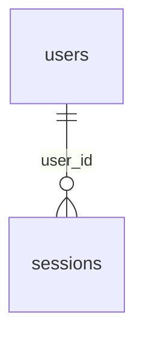

# `sessions`

Серверные сессии. В cookie лежит случайный токен (32 байта), в БД хранится только `sha256(token)`, поэтому утечка БД не даёт войти.

- Группа: организации и пользователи
- sqlc-модель: `repository.Session`
- API: `POST /auth/login`, `POST /auth/logout`, middleware аутентификации

## Поля

| Поле | Тип | NULL | По умолчанию | Go (sqlc) | Описание |
|---|---|---|---|---|---|
| `token_hash` | `bytea` PK | нет | — | `[]byte` | SHA-256 токена, ровно 32 байта |
| `user_id` | `uuid` FK → `users.id` ON DELETE CASCADE | нет | — | `uuid.UUID` | |
| `created_at` | `timestamptz` | нет | `now()` | `pgtype.Timestamptz` | |
| `expires_at` | `timestamptz` | нет | — | `pgtype.Timestamptz` | Абсолютный срок жизни |
| `last_seen_at` | `timestamptz` | нет | `now()` | `pgtype.Timestamptz` | Последняя активность |
| `ip` | `inet` | да | — | `*netip.Addr` | |
| `user_agent` | `text` | да | — | `pgtype.Text` | |

## Ограничения и индексы

- `CHECK (length(token_hash) = 32)`.
- `sessions_user_idx (user_id)` — удаление всех сессий пользователя.
- `sessions_expires_idx (expires_at)` — чистка просроченных.

## Связи

- Ссылается на: [`users`](users.md).

## sqlc-запросы (`queries/sessions.sql`)

| Запрос | Тип | Что делает |
|---|---|---|
| `CreateSession` | `:one` | Создаёт сессию при логине |
| `GetSessionByTokenHash` | `:one` | Сессия + `email, role, status, organization_id` пользователя (JOIN `users`). Отсекает просроченные и заблокированных |
| `TouchSession` | `:exec` | `last_seen_at = now()` |
| `DeleteSessionByTokenHash` | `:exec` | Logout |
| `DeleteSessionsByUserID` | `:exec` | Выход со всех устройств, блокировка пользователя |
| `DeleteExpiredSessions` | `:exec` | Периодическая чистка |
