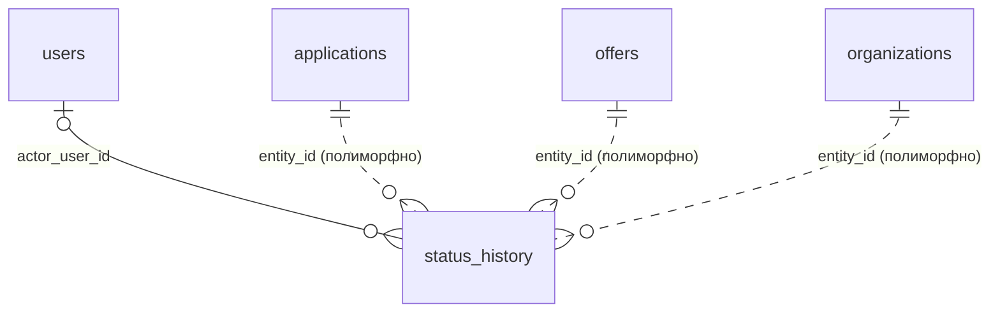

# `status_history`

Журнал переходов статусов заявки, оффера и KYC. Заменяет версионирование сущностей.

- Группа: служебные
- sqlc-модель: `repository.StatusHistory`
- API: `GET /applications/{id}/history`

## Поля

| Поле | Тип | NULL | По умолчанию | Go (sqlc) | Описание |
|---|---|---|---|---|---|
| `id` | `bigint` identity PK | нет | — | `int64` | |
| `entity_type` | `entity_type` | нет | — | `EntityType` | `application`, `offer`, `organization` (KYC) … |
| `entity_id` | `uuid` | нет | — | `uuid.UUID` | `id` сущности (без FK) |
| `from_status` | `text` | да | — | `pgtype.Text` | NULL — создание |
| `to_status` | `text` | нет | — | `string` | |
| `actor_user_id` | `uuid` FK → `users.id` | да | — | `pgtype.UUID` | NULL = система |
| `actor_role` | `user_role` | да | — | `NullUserRole` | Роль на момент действия |
| `comment` | `text` | да | — | `pgtype.Text` | Причина, комментарий модератора |
| `created_at` | `timestamptz` | нет | `now()` | `pgtype.Timestamptz` | |

## Ограничения и индексы

- `status_history_entity_idx (entity_type, entity_id, created_at)`.

## Связи



- Ссылается на: [`users`](users.md) (необязательно).
- Полиморфно (пунктир, без FK): [`applications`](applications.md), [`offers`](offers.md), [`organizations`](organizations.md).

## sqlc-запросы (`queries/applications.sql`)

| Запрос | Тип | Что делает |
|---|---|---|
| `CreateStatusHistory` | `:one` | Записать переход. Вызывать в той же транзакции, что и смену статуса |

**Нет запроса на чтение** для `GET /applications/{id}/history`. Нужно добавить, например:

```sql
-- name: ListStatusHistory :many
SELECT * FROM status_history
WHERE entity_type = $1 AND entity_id = $2
ORDER BY created_at;
```
