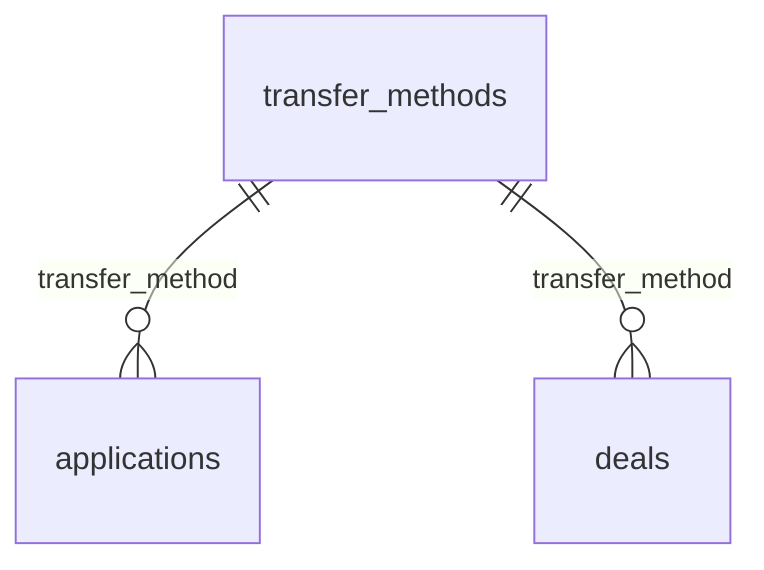

# `transfer_methods`

Справочник способов перевода: `swift`, `sepa`, `other`. Заполняется сидом `00002_seed_dictionaries.sql`.

- Группа: справочники
- sqlc-модель: `repository.TransferMethod`
- API: `GET /dictionaries/transfer-methods`

## Поля

| Поле | Тип | NULL | По умолчанию | Go (sqlc) | Описание |
|---|---|---|---|---|---|
| `code` | `text` PK | нет | — | `string` | Код способа: `swift`, `sepa`, `other` |
| `name` | `text` | нет | — | `string` | Название для показа |

## Связи

- На неё ссылаются: [`applications`](applications.md), [`deals`](deals.md).

## sqlc-запросы (`queries/dictionaries.sql`)

| Запрос | Тип | Что делает |
|---|---|---|
| `ListTransferMethods` | `:many` | `code, name`, сортировка по `code` |
