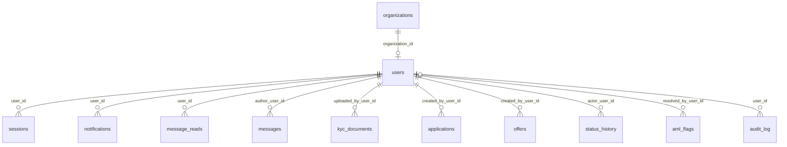

# `users`

Учётные записи. Админ не привязан к компании, заёмщик и кредитор — обязательно. В MVP один аккаунт на компанию.

- Группа: организации и пользователи
- sqlc-модель: `repository.User`
- API: `POST /auth/register`, `POST /auth/login`, `GET /auth/me`, `GET /admin/users`, блокировка/разблокировка

## Поля

| Поле | Тип | NULL | По умолчанию | Go (sqlc) | Описание |
|---|---|---|---|---|---|
| `id` | `uuid` PK | нет | `gen_random_uuid()` | `uuid.UUID` | |
| `email` | `citext` UNIQUE | нет | — | `string` | Регистронезависимый, ≤ 254 символов |
| `password_hash` | `text` | нет | — | `string` | argon2id, PHC-строка |
| `role` | `user_role` (`admin` / `borrower` / `lender`) | нет | — | `UserRole` | |
| `status` | `user_status` (`active` / `blocked`) | нет | `'active'` | `UserStatus` | |
| `organization_id` | `uuid` FK → `organizations.id` ON DELETE RESTRICT | да | — | `pgtype.UUID` | NULL только у админа |
| `blocked_reason` | `text` | да | — | `pgtype.Text` | Причина блокировки |
| `last_login_at` | `timestamptz` | да | — | `pgtype.Timestamptz` | |
| `created_at` | `timestamptz` | нет | `now()` | `pgtype.Timestamptz` | |
| `updated_at` | `timestamptz` | нет | `now()` | `pgtype.Timestamptz` | Обновляет триггер `users_updated_at` |

## Ограничения и индексы

| Имя | Что проверяет |
|---|---|
| `users_admin_org_chk` | `role = admin` ⇔ `organization_id IS NULL` |
| `users_one_per_org_uq` | Один пользователь на компанию (частичный уникальный индекс). Чтобы разрешить сотрудников — удалить |
| `UNIQUE (email)` | |

Соответствие `role` ↔ `organizations.type` проверяет сервис регистрации.

## Связи

- Ссылается на: [`organizations`](organizations.md).
- На неё ссылаются: [`sessions`](sessions.md) (CASCADE), [`notifications`](notifications.md) (CASCADE), [`message_reads`](message_reads.md) (CASCADE), [`messages`](messages.md), [`kyc_documents`](kyc_documents.md), [`applications`](applications.md), [`offers`](offers.md), [`status_history`](status_history.md), [`aml_flags`](aml_flags.md), [`audit_log`](audit_log.md) (SET NULL).

## sqlc-запросы (`queries/users.sql`)

| Запрос | Тип | Что делает |
|---|---|---|
| `GetUserByID` | `:one` | Пользователь по `id`, включая `password_hash` |
| `GetUserByEmail` | `:one` | Для логина, включая `password_hash` |
| `CreateUser` | `:one` | Регистрация (`email, password_hash, role, organization_id`) |
| `UpdateLastLogin` | `:exec` | `last_login_at = now()` |
| `BlockUser` | `:one` | → `blocked` с причиной |
| `UnblockUser` | `:one` | → `active`, очищает причину |
| `ListUsers` | `:many` | Админский список: фильтры `role`, `status`, `q` (ILIKE по email), пагинация |
| `CountUsers` | `:one` | Счётчик для того же фильтра |

Замечания:
- `BlockUser` не удаляет сессии. В той же транзакции нужно вызвать `DeleteSessionsByUserID` ([`sessions`](sessions.md)).
- У модели `User` есть JSON-тег `password_hash` (`emit_json_tags: true`). Модель нельзя отдавать в ответ API напрямую — только через DTO.
